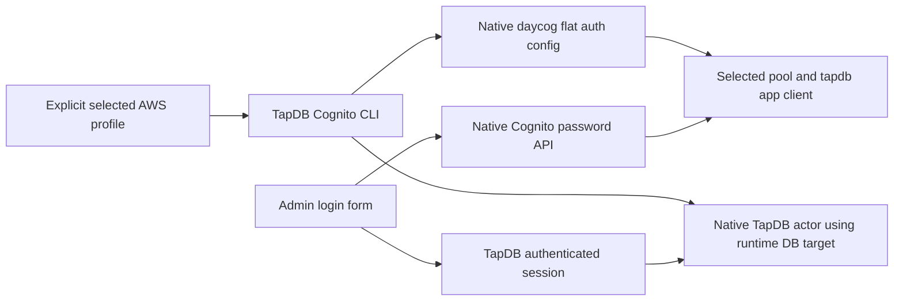

# Native Cognito Admin authentication

TapDB uses the pinned `daylily-auth-cognito` public boundaries. Standalone
password login calls `CognitoAdminClient` and its native password functions.
Authenticated provisioning uses a verified Cognito **access token** and its
stable subject. The native token verifier expects the access-token `client_id`
claim; an ID token is not interchangeable with that contract.

## Explicit configuration

Set `target.cognito_auth_config_path` using
`tapdb db-config update --cognito-auth-config-path` and an absolute path. Every
TapDB-to-Daycog command passes that exact file with `daycog --config`. Native
Daycog 2.1.9 uses a flat file. Legacy `contexts` / `active_context` stores,
home-directory inference, environment-shaped context emulation and automatic
format conversion are not supported.

The standalone GUI requires explicit `target.cognito_user_pool_id`,
`cognito_app_client_id`, `cognito_client_name` (exactly `tapdb`) and
`cognito_region`. `cognito bind` copies these values, plus the selected optional
hosted-login URLs, from the native auth-config file. It requires the exact pool
and client IDs; they must match that selected file. Native password login does
not require hosted-login URLs. Clients with a secret require the actual secret
in `target.cognito_app_client_secret` through the existing configuration command.
A binding never overwrites that separately supplied secret.

## Existing pool: create only the new app client

Use these commands with the selected TapDB target config and actual values:

1. `cognito add-app --pool-name ... --app-name tapdb --profile ... --region ...
   --callback-url ... --logout-url ... --read-attributes ...` delegates native
   app-client creation. Supply explicit comma-separated readable attribute names
   supported by the selected pool. Include only attributes needed by this client;
   custom attributes retain their native `custom:` names. The wrapper forwards
   this list unchanged to Daycog's published CLI. Daycog retains its existing
   email-only write permission for the new client.
   It rejects an existing client; it does not edit the pool, an existing client
   or the pool's hosted domain. The callback/logout URLs must describe the
   selected HTTPS GUI.
   The selected auth-config file may not exist yet: native `add-app` explicitly
   permits a missing config when the AWS profile and region are supplied.
2. `cognito config create --pool-id ... --client-name tapdb --profile ...
   --region ...` imports the selected pool/client through native
   `daycog auth-config create`. The native command writes the supported flat
   file. `config update` explicitly refreshes an existing selected file;
   neither command fabricates a context or chooses among multiple clients.
3. `cognito bind --pool-id ... --client-id ...` binds those actual identities
   from the imported file to the selected TapDB GUI config.
4. With an explicit native attribution envelope, run `cognito add-user EMAIL
   --password ... --role admin --name ... --no-verify` to create the Cognito
   identity and its native actor. The native Daycog user operation sets
   `suppress_message=True`, which sends `MessageAction=SUPPRESS` to Cognito.
   With `--no-verify` and an explicit password it marks email verified and sets
   that password permanently. It sends no invitation. Secrets belong in private
   inputs and must not be echoed into logs.
5. Launch the native Admin with the runtime database target and its selected
   HTTPS certificate/key. The application receives no operator DB config.

The Cognito identity is created before the TapDB actor. If actor creation fails,
the command reports that partial result and stops. There is no automatic retry,
account deletion, privilege upgrade or alternate authentication path.

For a pool exposing `custom:tenant_id`, include that exact name in the explicit
read-attribute list. This permits reading the existing verified claim; it does
not create a claim value, provision membership, or authorize a tenant. The host
application maps verified claims into its native UUID `tenant_id` context and
enforces its own membership and role rules. Cognito subjects identify users;
tenant IDs identify data scope; Meridian issuance ownership is independent of
both. A `custom:customer_id` attribute is not a substitute for that contract.

`cognito setup` and `setup-with-google` retain native pool provisioning. They
require an explicit pool name, region and AWS profile and write the same native
flat config before binding it. These commands have broader effects than adding
one client and are not the existing-pool client-only procedure above.

## Launch contract

The supported image entrypoint reads explicit `TAPDB_CONFIG_PATH`,
`TAPDB_ADMIN_HOST`, `TAPDB_ADMIN_PORT`, `TAPDB_ADMIN_TLS_MODE=https`,
`TAPDB_ADMIN_TLS_CERTFILE` and `TAPDB_ADMIN_TLS_KEYFILE`. Its configured port must
match `target.ui_port`. Bind the config to its recorded absolute path. Keep the
same runtime principal, tenant scope, issuance profile and attribution policy.
An existing selected AWS profile can be provided with its actual
`AWS_CONFIG_FILE` and `AWS_PROFILE`; the auth wrapper does not infer another
profile or repair credentials.

The source repair does not establish a successful live login. Native account
creation, actual GUI authentication and the requested GUI/API product operations
remain separate execution results.
