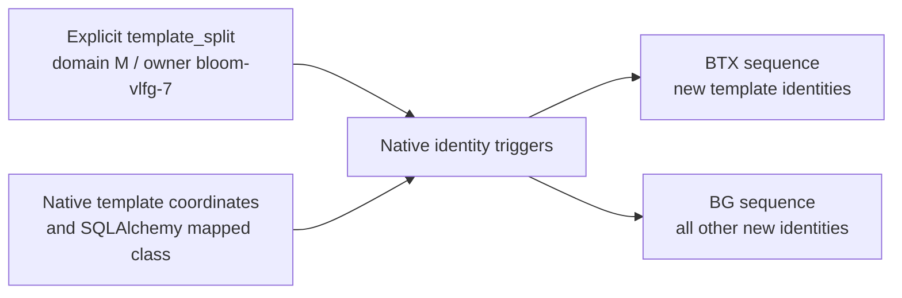
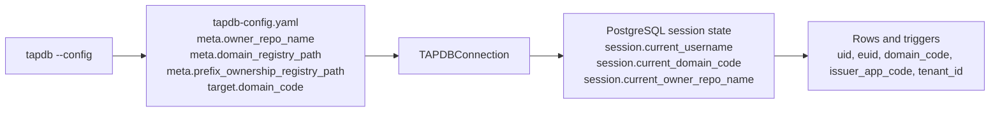

# TAPDB Identity and Scoping

TAPDB keeps five identity or scope concepts separate: `uid`, `euid`,
`domain_code`, `issuer_app_code`, and `tenant_id`.

The short version is:

- `uid` is the internal database primary key.
- `euid` is the external Meridian identifier used for labels, URLs, and
  user-facing references.
- `domain_code` is the required Meridian domain namespace.
- `issuer_app_code` is the persisted owner token column used by row-level scope.
  In TapDB 0.4.1 the value stored there is the repo-name ownership token.
- `tenant_id` is the tenant UUID and is independent from Meridian identity.

TapDB treats the external identifier as opaque. Object meaning comes from
database lookup and template metadata, not from parsing the identifier text.

## Identity Layers

| Value | What it is | What it is not |
| --- | --- | --- |
| `uid` | `BIGINT` primary key generated by the database | Not a Meridian identifier, not a tenant ID, not a label |
| `euid` | Meridian Enterprise Unique Identifier | Not a UUID and not a semantic payload |
| `domain_code` | Meridian domain namespace / RLS scope | Not a tenant and not folded into template category |
| `issuer_app_code` | Persisted owner token / RLS scope column | Not a separate TapDB app-code concept |
| `tenant_id` | Multi-tenant UUID scope | Not Meridian identity and not part of the EUID string |

These layers are used together:

- `uid` is used for joins and foreign keys.
- `euid` is what people see and copy.
- `domain_code` is mandatory for issuance and template resolution.
- `issuer_app_code` stores the repo-name ownership token used for row scope.
- `tenant_id` remains separate tenancy state.

## Meridian EUIDs

TapDB uses `meridian-euid==0.4.8` for canonical Meridian formatting and
checksum validation:

```text
DOMAIN-PREFIX-BODYCHECKSUM
```

When documentation needs an example, capture the value returned after the
owning service persists the object:

```text
<persisted-euid>
```

Important rules:

- Domain is required.
- Prefix is required.
- `:` forms and domainless forms are rejected.
- EUIDs are opaque.
- Do not infer object type, tenant, workflow state, or routing from the string.
- Do not handcraft EUIDs.
- Do not substitute UUIDs for EUIDs.

## Explicit issuance profiles

Every config must declare `meta.issuance_profile`. There is no omitted-profile
default. Select canonical allocation explicitly to retain TapDB's canonical
core prefixes and each application template's declared prefix:

```yaml
meta:
  issuance_profile:
    version: 1
    mode: canonical
```

A deployment can select one registry-owned prefix for all new identities using
`single_prefix`. To separate template identities from every other identity,
use `template_split`. Bloom's prospective split is:

```yaml
meta:
  client_id: bloom
  database_name: vlfg-7
  owner_repo_name: bloom-vlfg-7
  issuance_profile:
    version: 1
    mode: template_split
    prefix: BG
    template_prefix: BTX
target:
  domain_code: M
```

These are identity fragments, not complete connection configurations. The
producer application is the explicit `client_id`; the registry/RLS owner is
`owner_repo_name`. A deployment owner is not a service routing identifier.
The registry must grant the exact domain/prefix to that owner before bootstrap.
Neither a new database name nor a new owner creates another sequence space in
the externally visible EUID. Prefix availability and ownership must therefore
be established before a second database starts issuing identities.

`db-config init` requires `--issuance-profile-json`; `db-config update` accepts
the same flag to replace the complete requested profile. The supported shapes
are `{"version":1,"mode":"canonical"}`,
`{"version":1,"mode":"single_prefix","prefix":"BG"}` and
`{"version":1,"mode":"template_split","prefix":"BG","template_prefix":"BTX"}`.
Every field shown is explicit; prefixes are exact registered values, and a
split requires distinct base and template prefixes. Changing a config
does not rewrite a persisted database profile. Native schema bootstrap binds
the profile to `(domain_code, issuer_app_code)` and rejects a conflicting
existing binding. Upgrading a package/config alone does not install this schema
contract on an existing database.

`db-config update --additional-tenant-ids-json` replaces the complete additional
tenant allowlist using native UUID validation. Use an explicit JSON array,
including `[]` when no additional tenants are authorized. Set this list before
binding the runtime principal; changing the config alone cannot change an
existing immutable database scope binding.

After provisioning and native binding, `db-config update --remove-operator`
removes the complete `target.operator` mapping without changing the runtime
identity or the canonical config path. It cannot be combined with operator
credential options. This produces a runtime-only config; future operator work
requires explicitly supplying operator credentials through the native config
interface again.

In `template_split`, new template EUIDs use `btx_instance_seq`. Material/container
instances, lineage edges, audit records, actors, messages, external references,
sets, saved queries, DAG views and governance instances continue to share
`bg_instance_seq`. Under `single_prefix`, templates also use that base sequence.
Internal SQL primary-key sequences remain unchanged. Bundled core definitions are
authenticated against the installed package before their allocation prefix is
projected; their coordinates, schemas, mapped classes and reference semantics
remain canonical. New application templates must explicitly declare
`instance_prefix: BG`, even when the template's own EUID uses BTX. Runtime
authoring requires the configured template allocator and declared instance
allocator, with existing runtime USAGE; it creates no sequences and obtains no
operator privileges. Both exact domain/prefix claims belong to `bloom-vlfg-7`.



Python consumers pass the explicit resolved profile to
`TAPDBConnection(issuance_profile=cfg["issuance_profile"], ...)`. The native
engine carries that profile into SQLAlchemy sessions, including an
application's own sessionmaker bound to that engine. Prefixes never select an
ORM class or substitute for native four-part template resolution. A core XRF
still uses its exact external-reference template even when its prefix is
shared with other objects.

Persisted EUIDs and existing template definitions remain immutable. Future
granular prefixes require a separately authorized native profile change and
new template versions/objects; they must never rewrite historical EUIDs or
reassign an active prefix to another allocator.

### Prospective template-prefix transition

For an existing `single_prefix` database, `db issuance-profile transition` is
the explicit operator lifecycle. It supports only an unchanged base prefix
with a newly selected, distinct template prefix; changing domain, owner or any
other allocation role is outside this operation. Prefix availability and exact
ownership must already be established through native registry/allocation
controls. This command does not discover another allocator or borrow its
sequence position.

Keep the config on the old profile until apply succeeds. Use the same explicit
operator config, attribution envelope and receipt for plan and apply. The
following absolute paths illustrate caller-supplied files:

```sh
tapdb --config /absolute/path/tapdb-config.yaml \
  --attribution /absolute/path/operator-attribution.json \
  db issuance-profile transition \
  --expected-profile-json '{"version":1,"mode":"single_prefix","prefix":"BG"}' \
  --new-profile-json '{"version":1,"mode":"template_split","prefix":"BG","template_prefix":"BTX"}' \
  --receipt /absolute/path/template-prefix-plan.json
```

The read-only plan binds the configured target and authenticated physical
database, native release, operator attribution, existing profile/bindings and
exact governed claims. Review that receipt, then run the same command with
`--apply`; the native operation consumes the unchanged receipt. Global
`--dry-run` retains plan behavior. Apply installs the native profile-column and
constraint upgrade where needed, replaces the packaged allocator routines,
provisions the separate sequence through the native allocator service, changes
only the template identity binding and profile, and applies native proven
allocator grants to the existing runtime. These changes commit together.
Allocation writes take native locks during this deployment step.

The result is written beside the plan with `.result.json` appended to its
stem. Its `new_profile` is the input for the subsequent native
`db-config update --issuance-profile-json` operation on the same config path;
restart consumers with that explicit profile. The transition itself neither
rewrites config nor starts a service. Ordinary bootstrap still rejects a
conflicting persisted profile, so editing config alone cannot bypass this
lifecycle. Failed transactions roll back their database changes; a successful
apply is not replayed.

Existing BG templates remain readable, immutable and usable for their existing
instances. No template EUID, object identity, history or base-sequence position
changes. Publishing a new application template version creates a new BTX
template identity; it does not edit or renumber the old definition.

## Runtime Context

TapDB has two relevant runtime layers:

1. CLI/config namespace context.
2. PostgreSQL session context.

### CLI / Config Namespace

The supported CLI form is:

```bash
tapdb --config <path> ...
```

The config metadata must include:

- `meta.client_id`
- `meta.database_name`
- `meta.owner_repo_name`
- `meta.issuance_profile`
- `meta.domain_registry_path`
- `meta.prefix_ownership_registry_path`
- `target.domain_code`
- `target.database`
- `target.schema_name`

There is no client-code-derived prefix behavior, no passive prefix inheritance,
and no compatibility path for missing governance metadata.

The public Meridian domain-code authority is
[`lsmc-bio/meridian-registry`](https://github.com/lsmc-bio/meridian-registry).
TapDB consumes it through `meridian-euid==0.4.8`, which pins public registry
version `0.1.1` and exposes `meridian-euid domain-check ... --registry-index`.
The configured `meta.domain_registry_path` is still a local runtime fixture used
to assert that the selected deployment domain is registered for that runtime.
The configured `meta.prefix_ownership_registry_path` remains the only prefix
ownership input; `meridian-registry` does not centralize prefixes.

### PostgreSQL Session Context

The Python connection layer sets session values before work begins:

- `session.current_config_identity` for the exact explicit config path
- `session.current_schema_name` for the configured PostgreSQL schema
- `session.current_username` for audit attribution
- `session.current_domain_code` for Meridian domain scope
- `session.current_owner_repo_name` for repo ownership scope
- `session.current_tenant_id` for the optional fixed tenant UUID
- `session.allow_global_rows` for the explicitly configured global-claim capability

For an unprivileged runtime login, these settings are assertions rather than
authority. Forced-RLS accessors derive scope from the operator-owned
`tapdb_runtime_principal_scope` row keyed by the authenticated PostgreSQL
principal and reject any mismatching GUC value. Direct `SET`, `PGOPTIONS`, or a
temporary-schema shadow cannot switch tenants or widen global-row access.

`target.tenant_id` is an optional canonical UUID. When present it fixes every
config-backed web/CLI transaction to that tenant; request parameters cannot
change it. Absence deliberately creates a global-only runtime. The distinct
`target.operator` credentials are required for schema apply, migration, drift
inventory, and global seed operations and must authenticate as `SUPERUSER` or
`BYPASSRLS`. Runtime and backup paths never inherit that privilege.

Runtime ownership inputs:

- `MERIDIAN_DOMAIN_CODE`
- `TAPDB_OWNER_REPO`

There is no fallback domain, no fallback owner token, and no separate legacy
app-code mode.

## Template Scope

Template taxonomy remains:

```text
category/type/subtype/version/
```

In TapDB, `category` is the top-level object taxonomy bucket. Domain is
separate and mandatory; Meridian EUID minting is controlled by
`instance_prefix`.
The effective template identity is:

```text
(domain_code, issuer_app_code, category, type, subtype, version)
```

Domainless template lookup is forbidden. All template queries and uniqueness
checks must include both `domain_code` and the owner-scoping
`issuer_app_code`.

## Row-Level Scope

TapDB row-level policies use `domain_code`, `issuer_app_code`, and `tenant_id`
together:

- `domain_code`: which Meridian domain is this row valid in?
- `issuer_app_code`: which repo ownership token minted or handles this row?
- `tenant_id`: which tenant does this row belong to?

Do not substitute one for another.



## Practical Rules

- Use `uid` for internal joins and foreign keys.
- Use `euid` for external references and user-facing object identity.
- Use `domain_code` for Meridian namespace separation.
- Use `owner_repo_name` / `TAPDB_OWNER_REPO` as the runtime ownership input.
- Treat persisted `issuer_app_code` values as the repo-name ownership token.
- Use `tenant_id` only for tenancy.
- Treat `euid` as opaque lookup data, not business logic.
