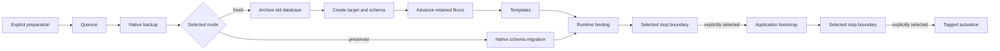

# Native operator migrations — TapDB 14.0.0

TapDB 14.0.0 pins `meridian-euid==1.0.0`. Package installation and image
publication do not apply a database migration or activate an application.

## Meridian transition

| Stored/input shape (abstract grammar) | Behavior |
| --- | --- |
| `DOMAIN-PREFIX-BODYCHECKSUM` | Two hyphens select the original checksum; keep the exact ID |
| `DOMAIN-PREFIX-BODY-CHECKSUM` | Three hyphens select the new checksum |
| Single-hyphen legacy input or empty components | Fail |

New Python and PostgreSQL issuance uses the three-hyphen form. The new payload
is `DOMAIN-PREFIX-BODY-`; all three hyphens have value zero and consume a MOD 32
weight position. The old payload and calculation are unchanged. Readers select
one algorithm from syntax and never try the other after failure.

The packaged migration `20261114_180000_meridian_separated_checksum.sql`
replaces functions only. It preserves stored EUIDs, UIDs, lineage, audit rows,
sequence positions, and retained floors. Supplied old IDs are checked against
their own format, instead of compared to the output of the new issuer.

Upgrade every reader that will receive new IDs before switching native issuance.
Apply the packaged migration through the existing explicit-target native schema
migration command and its receipt/fence controls. Both formats can coexist in
one database. Rewriting existing IDs or merely inserting a hyphen is not an upgrade.

## Complete operator environment

`ghcr.io/daylily-informatics/tapdb-operator:14.0.0` is the release's operator
image destination. Its build recipe is `docker/operator.Dockerfile`; the release
publication records whether the image has actually been pushed and its digest.

- PostgreSQL 16.15 clients and their Debian Bookworm runtime dependencies come
  from one digest-pinned official PostgreSQL image.
- Digest-pinned uv 0.11.16 installs Python 3.12.12 and the frozen TapDB lock file.
- TapDB source is the exact 14.0.0 tagged revision; Meridian is exactly 1.0.0.
- The image records installed OS package versions in `/opt/operator-os-packages.txt`.
- It starts the TapDB CLI as UID 1000. It does not start a PostgreSQL server.

Build only on the designated EC2 host, from the final numeric release tag.
Do not assemble Ubuntu PostgreSQL binaries inside Debian containers. Select
this complete environment, or another explicitly supported complete operator
environment, before downtime. A PostgreSQL 15 dump client is not suitable for
the reviewed PostgreSQL 16 source; existing native client-version controls remain.

For container execution, mount the config, AWS config/credential paths, CA file,
attribution envelope, recovery journals and receipt directories at their exact
absolute paths. Keep credential files read-only and make native log/output
directories writable by the selected operator UID. Do not bake credentials into
the image. For IAM access on EC2, explicitly choose the network/credential access
configuration appropriate to the host; there is no automatic backend discovery.

## Prepare before stopping a service

Resolve these inputs before quiescence:

| Input | Requirement |
| --- | --- |
| TapDB config | Exact absolute path and physical database/schema identity |
| Execution backend | Explicit native executable or complete container invocation |
| PostgreSQL clients | Matching supported major and OS dependency closure |
| AWS access | Explicit profile and absolute AWS config path for that executor |
| Logs and receipts | Writable absolute paths; retain the original recovery journals |
| Attribution | Explicit v1 actor/service JSON; forward it to application child processes |
| Migration mode | `preserved` existing database or `fresh` replacement |
| Stop boundary | Explicit `runtime_bind`, `app_bootstrap`, or `activate` |

The runtime binding step follows schema/template work and precedes application
seeding. Restarting an application, switching an image, or activating a service
is a separately selected stage. A prepared run stopping at `app_bootstrap` does
not activate anything.

## Receipt-driven stage runner

`tapdb db migration-run` composes existing commands; it does not replace their
fences, receipts, destructive-action confirmations, or failure handling.



A definition is a JSON object with exactly these fields:

- `run_id`: operator-chosen lowercase letters, digits and underscores.
- `mode`: `preserved` or `fresh`.
- `stop_after`: `runtime_bind`, `app_bootstrap`, or `activate`.
- `execution_backend`: explicit descriptive backend name.
- `operator_argv`: complete argument array ending at the native TapDB executable
  or container entrypoint. Its first executable path is absolute. The runner
  appends `--config`, `--attribution`, and each native command's arguments.
- `working_directory`, `log_directory`, `aws_config_file`, `attribution`:
  explicit absolute paths. `aws_profile` is the explicit profile name.
- `stages`: an ordered list of objects with `kind` and `commands`.

Native commands contain `config` (an absolute path) and `argv` (a string array
starting at the native subcommand, for example `db`, `schema`, `migrate`).
External commands contain only `argv`, beginning with an absolute executable.
Shell command strings are not accepted. Application bootstrap arguments must
explicitly forward `--attribution` and its envelope path. Include the application's
own backend selector where required. The runner never guesses it.

Stage order is `quiesce`, optional `source_capture`, `backup`, then the selected
mode's stages, followed by `runtime_bind`, optional `app_bootstrap`, and optional
`activate`. Fresh replacement requires `archive`, `create_target`, `schema_apply`,
`allocator_advance`, and `templates`. Preserved migration requires `schema_migrate`
and can include an explicitly needed `schema_apply` or `templates` stage.

Each stage can contain native plan/apply command pairs with exact evidence
paths. `schema_migrate`, `allocator_advance`, and `runtime_bind` must end with
their owning `--apply` command. The archive stage can first run `db archive fence
--apply` and then `db archive retain`. Native confirmation requirements are not
answered by the runner. Never add blanket confirmation flags to a definition.

```bash
tapdb --config /absolute/operator/target.yaml db migration-run prepare \
  --definition /absolute/operator/migration-definition.json \
  --receipt /absolute/operator/prepared-run.json

tapdb --config /absolute/operator/target.yaml db migration-run resume \
  --plan /absolute/operator/prepared-run.json \
  --receipts-dir /absolute/operator/run-journal
```

Preparation resolves existing native config requirements, the attribution
envelope, paths and selected lifecycle before service shutdown. Native command
results remain the authority: exit zero records completion and no second probe
is added. stdout/stderr are retained per command and attempt; native stderr
progress is also relayed to the operator.
The successful stdout is also retained at `RUN_ID_COMMAND_INDEX.stdout` in the
selected log directory, with a three-digit zero-padded command index. Later
stages can consume that stable path after a retried command succeeds.

Resume skips completed commands. A successful allocator advance is never
repeated merely because application seeding failed later. Native nonzero exits
stop the run and propagate failure. Resume retries the unfinished command under
its original native controls. If those controls require reconciliation or a
changed reviewed plan, complete that owning operation first; the runner does
not invent new receipt paths or bypass a fence.

An interrupted launch with no recorded outcome is ambiguous and is not retried.
Use the owning command's reconciliation procedure, then `migration-run reconcile`
with an explicit JSON result containing `plan_sha256`, `command_index`,
`disposition` (`succeeded` or `retryable`) and the absolute `native_receipt` path.
This records the operator's disposition against retained native evidence; it
does not itself reconcile a database, erase allocator reservations, or release
a writer fence. A different target, command definition or TapDB version needs
a new reviewed plan, not edits to an existing run.
Successful reconciliation consumes the owning result: committed allocator or
migration evidence, applied runtime binding, native archive/fence outcome or
successful backup result. Other commands require a retained exit result with
`returncode: 0`. A retryable disposition never marks a stage complete.

## Native progress and capture cost

Schema migration emits progress on stderr from the executing operation:
asset/history loading, each table's inventory capture, source comparison,
each SQL migration, preservation comparison, allocator advancement, commit,
native completion, fence release, and final receipt writing. These are events
inside existing stages, not periodic polling, new probes, or extra checks.

Preflight reuses the identity and sequence inventories it already captured in
the same snapshot when composing the source contract. It no longer scans the
full history again for that composition. This is not cross-transaction caching;
an old on-disk inventory is not substituted for current capture. Existing
preservation comparisons and post-commit controls remain intact.

Receipt files already use incremental JSON encoding. `db identity inventory
--receipt /absolute/operator/source.json --receipt-only` now avoids serializing
the entire inventory again to stdout. The complete evidence stays in the file.
Explicit compact audit mode remains available only for its reviewed migration
closures, including this exact function-only Meridian migration. No limits are
automatically raised and no measured speedup is claimed without an actual run.

## Archived and retained

After a successful native backup and source contract, `db archive fence --apply`
uses the existing native acquisition API to close the old database's connection
gate. It deliberately leaves the gate closed when its operator sessions end.
Use explicit `--source-contract`, `--control-config`, `--receipts-dir`, and new
`--receipt` paths; supply the existing provider/quarantine contracts where required.

`db archive retain` consumes the successful native fence, source contract,
backup result and original journals. It writes the `archived_retained` result
into the existing fence journal and a selected receipt file. It does not delete
the old database, read the backup again, reset counters, restore ACLs, or open
connections. It records the physical source identity, backup location, source
contract, recovery family, original fence and retained allocator floors.

```bash
tapdb --config /absolute/operator/source.yaml db archive retain \
  --fence /absolute/operator/source-fence.json \
  --source-contract /absolute/operator/source.json \
  --backup-result /absolute/operator/backup-result.json \
  --receipts-dir /absolute/operator/recovery-journal \
  --backup-receipts-dir /absolute/operator/backup-journal \
  --receipt /absolute/operator/archived-retained.json
```

To restore or reactivate an archived generation:

1. Keep its original receipt, backup, config identity, recovery family and all
   journal roots. Account for every later generation, including failed and
   ambiguous allocator reservations.
2. Quiesce each known physical generation through native writer-fence
   reconciliation, including the archived database. Retain each latest successful
   family-bound quarantine receipt. Application writes since an earlier backup
   must be represented by those current native allocator observations.
3. Run `db archive restore-plan` with `--archive`, a new `--receipt`, and repeated
   `--generation-quarantine` paths for every known generation. It unions their
   high-water observations and the original/family retained floors. Missing
   generation evidence fails; it never opens a gate.
4. Feed that plan's `floors` into the existing native reviewed recovery/sequence
   advance workflow, retaining its explicit recovery family and original journals.
   Use the owning backup/fence controls for restore and release. Bind runtime
   access before any separately authorized activation.

The registry and recovery family cannot detect undeclared writable database
copies. They coordinate declared allocation authority and recorded generations;
they do not introduce a global allocator service.
