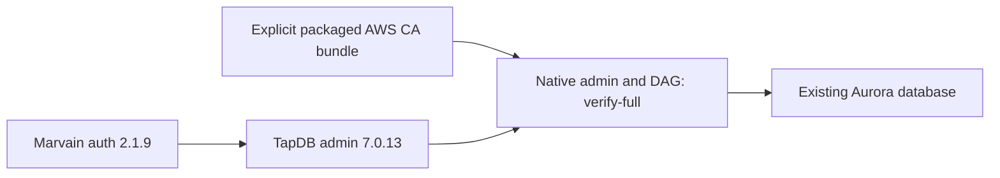

# TapDB 7.0.13 — Marvain hosted authentication repair

## Current continuation state

Owner: Marvain coordinator A0. Source baseline: immutable TapDB 7.0.12. Scope: repair the real pip ResolutionImpossible between TapDB admin auth 2.1.5 and Marvain auth 2.1.9; preserve native admin and DAG routes. The user's Marvain auth-refactor/deployment request and follow-up "can this be fixed?" authorize this owning dependency repair. The existing /Users/jmajor/projects/daylily/daylily-tapdb checkout on jem-dev and its unrelated AGENTS.md edits remain untouched. The managed-worktree tool did not return a checkout; source changes are published through the owning GitHub API on codex/marvain-auth-7-0-13.

The prior deployed setup encountered an actual AWS CA bundle checksum mismatch. Native admin and DAG engine builders now use the already parsed target.sslrootcert configuration and retain sslmode=verify-full. Missing explicit certificate configuration fails clearly. The caller packages the official manually provisioned AWS bundle. No runtime download, HOME override, monkeypatch, resolver bypass, schema change or migration is added.

Tests and extra QC remain off under the user's release policy. No PR or merge. Stop condition: annotated immutable 7.0.13 package published, then consumed by Marvain 4.0.3. Publication and deployed use will be recorded by the Marvain execution ledger /Users/jmajor/projects/marvain/docs/plans/20261109_marvain_4x_multiagent_execution_plan.md.

| Item | State | Evidence |
|---|---|---|
| Dependency repair | SUCCESS source | Admin extra pins daylily-auth-cognito==2.1.9. |
| Hosted native CA path | SUCCESS source | Both native engine builders consume explicit sslrootcert, retaining verify-full. |
| Package publication | IN_PROGRESS | Intended immutable annotated 7.0.13. |
| Marvain deployment | IN_PROGRESS | Owning Marvain ledger records final build/deploy receipts. |

