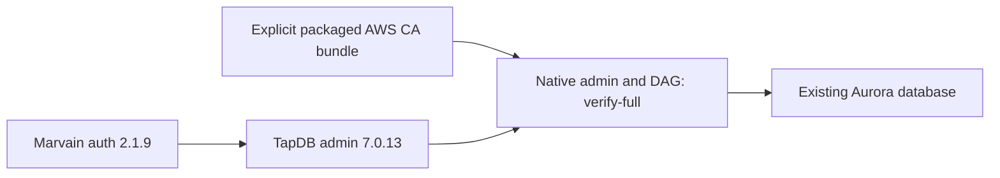

# TapDB 7.0.13 — Marvain hosted authentication repair

## Current continuation state

Completed: annotated 7.0.13 at fd4803f9bb1df463b5cc7129fceeeb10d2f24acf was published with the existing twup workflow (exit 0). Marvain 4.0.3 at 55f1266 installed this package successfully, built its final images/Lambda artifacts on EC2 (exit 0), and updated marvain4-prod in lsmc/us-east-2 successfully. No tests were run. Interactive owner sign-in remains unperformed. Evidence: /Users/jmajor/projects/marvain/build/releases/tapdb-7.0.13/package-build.log, /Users/jmajor/projects/marvain/build/releases/tapdb-7.0.13/package-publish.log, and /Users/jmajor/projects/marvain/build/releases/4.0.3/hub-deployment.log.

Owner: Marvain coordinator A0. Source baseline: immutable TapDB 7.0.12. Scope: repair the real pip ResolutionImpossible between TapDB admin auth 2.1.5 and Marvain auth 2.1.9; preserve native admin and DAG routes. The user's Marvain auth-refactor/deployment request and follow-up "can this be fixed?" authorize this owning dependency repair. The existing /Users/jmajor/projects/daylily/daylily-tapdb checkout on jem-dev and its unrelated AGENTS.md edits remain untouched. The managed-worktree tool was delayed; source changes were published through the owning GitHub API on codex/marvain-auth-7-0-13. Its later attached checkout at /Users/jmajor/.codex/worktrees/tapdb-marvain-auth-7-0-13/daylily-tapdb was unused; archive_worktree rejected removal because it is the chat's primary checkout. It remains preserved.

The prior deployed setup encountered an actual AWS CA bundle checksum mismatch. Native admin and DAG engine builders now use the already parsed target.sslrootcert configuration and retain sslmode=verify-full. Missing explicit certificate configuration fails clearly. The caller packages the official manually provisioned AWS bundle. No runtime download, HOME override, monkeypatch, resolver bypass, schema change or migration is added.

Tests and extra QC remain off under the user's release policy. No PR or merge. Stop condition: annotated immutable 7.0.13 package published, then consumed by Marvain 4.0.3. Publication and deployed use will be recorded by the Marvain execution ledger /Users/jmajor/projects/marvain/docs/plans/20261109_marvain_4x_multiagent_execution_plan.md.

| Item | State | Evidence |
|---|---|---|
| Dependency repair | SUCCESS source | Admin extra pins daylily-auth-cognito==2.1.9. |
| Hosted native CA path | SUCCESS source | Both native engine builders consume explicit sslrootcert, retaining verify-full. |
| Package publication | SUCCESS | Annotated 7.0.13 package build and publication exit 0. |
| Marvain deployment | SUCCESS | 4.0.3 stack update succeeded; owning Marvain ledger records final receipts. |

