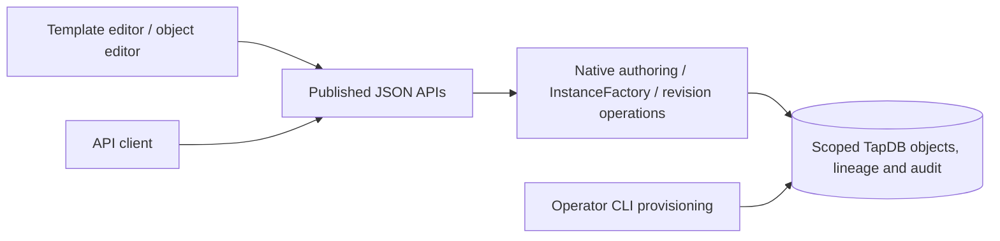

# Runtime template authoring and GUI API parity

TapDB's canonical GUI creates application templates through its published JSON
API. The runtime never calls the operator seed loader, changes the runtime
principal, provisions an allocator, or changes schema. Operator provisioning must
already grant the selected owner its exact prefix and allocation privileges.



## Explicit identity and scope

The normalized configuration must contain `issuance_profile`. Its source is
`meta.issuance_profile`, with either `{"version":1,"mode":"canonical"}` or
`{"version":1,"mode":"single_prefix","prefix":"BG"}`. A new application
template explicitly declares its effective `instance_prefix`; the runtime never
rewrites it. Semantic four-part coordinates and polymorphic classes are
independent of this allocation prefix.

`owner_repo_name` is the governed object owner. `client_id` is the producing
service recorded in authenticated audit attribution. They are distinct values.
The connection's existing tenant, global-row, domain and owner controls remain
in force. Template definitions use native global template scope; the runtime
must already have permission to create them. Instance creation uses the
configured native tenant.

Reserved operational prefixes and installed native core template coordinates
remain operator-provisioned. A shared application prefix does not authorize
replacing native core definitions. Existing template coordinates, including
retired ones, are immutable; publish a new version instead.

## Published operations

All paths below are relative to the canonical GUI mount. Authentication is the
same host or native session used by the GUI; write endpoints require its existing
admin role. Configured scope and native revisions apply equally to both clients.

| Operation | API | GUI |
|---|---|---|
| Create template definitions atomically | `POST /api/templates` | New Template / Save |
| Validate definition JSON shape | `POST /api/templates/validate` | Validate |
| Create typed instance and declared children | `POST /api/create/{template_euid}` | Create Instance |
| Update object fields | `PATCH /api/objects/{euid}` | Name, status and JSON editors use the corresponding published operations |
| Replace object JSON | `POST /api/object/{euid}/edit-json` | Save JSON |
| Create lineage | `POST /api/object/{euid}/lineage` | Add lineage |
| Export repository definitions and receipt | `POST /api/templates/repository/export` | Export New Repository Pack |
| Import repository definitions | `POST /api/templates/repository/import` | API; runtime authoring path |

A template body is an object containing a nonempty `templates` array. Each item
requires `name`, `polymorphic_discriminator`, `category`, `type`, `subtype`,
`version`, `instance_prefix`, `instance_polymorphic_identity` and `json_addl`.
Optional native fields are `json_addl_schema`, `validator_ref`, `bstatus` and
`is_singleton`. Unknown fields and caller-supplied database identities are
rejected. The response uses contract `tapdb.runtime-template-authoring/v1` and
contains `inserted` plus the persisted template payloads and their real EUIDs.

The instance body contains an exact nonblank `name`, object-valued `properties`
and explicit boolean `create_children`. Creation goes through `InstanceFactory`
and the native template manager, retaining mapped types, native property defaults
and child layouts. The response supplies `instance_euid`, `template_euid`,
`template_code` and `record_revision`.

Runtime template authoring and the regular instance factory construct the exact
SQLAlchemy class registered for the selected discriminator. They do not construct
a generic Python object carrying a different typed discriminator. The existing
native optional instance-class hint remains supported for bundled definitions;
runtime-authored definitions require that field explicitly. Unknown identities
fail. Natural-identity claims use the same class selection and native polymorphic
query when returning their persisted row.

JSON edits contain `apply`, `expected_revision`, a complete `json_addl` object and
an explicit `reason`. They update the actual object through the native revision
operation; they do not create an attribute-only repair record. Native history
retains the old and new values with actor, producer, operation and reason.

Lineage creation contains `related_euid`, `expected_revision`,
`related_expected_revision`, `direction` and `relationship_type`.
`direction: "parent"` means the related object is a parent of the addressed
object; `"child"` means it is a child. Canonical edge types require their native
`v0_edge` metadata. The response supplies the persisted lineage EUID and revision.
External-reference objects, saved queries and DAG views use their dedicated
native APIs, including their dedicated lineage operations.

The library entry point is
`daylily_tapdb.templates.runtime.author_templates(session, payload,
governance=..., issuance_profile=...)`. Its caller owns the existing native
transaction and attribution. It does not commit. Library template resolution
continues to use `TemplateManager.get_template` for exact four-part coordinates
and `get_template_by_euid` for persisted native identities.

Repository import explicitly selects `execution="runtime"` or
`execution="operator"` and supplies the issuance profile. The GUI API selects
runtime; the repository CLI selects operator. Existing repository receipts,
conflict handling and identical-definition skip behavior remain in that native
repository service.

## Backup form parity

Backup create, verify, rehearse, restore stage and restore apply forms submit to
the existing `/api/admin/backups` endpoints. Their service authorization,
operation results, receipts, staged plan fingerprints and required typed target
confirmation remain native. The GUI renders the API result and links any receipt
returned by that operation. A failed apply leaves the old apply form unavailable;
the operator reviews the failure and explicitly stages another attempt.

No backup operation is implied by installing this change. The duplicate HTML
POST mutation routes were removed; the HTML GET pages remain views.

## Embedding saved queries

`create_tapdb_gui_router` and `create_tapdb_gui_app` accept
`saved_query_executors`, an optional mapping of explicit executor names to native
`QueryExecutor` definitions. The mapping is passed to the canonical saved-query
router; hosts do not mount a second saved-query API. See
[saved queries](saved_queries.md) for definition ownership and execution contracts.

## Dedicated template identifiers

Canonical issuance can explicitly select a repository-owned `template_prefix`:

```yaml
meta:
  issuance_profile:
    version: 1
    mode: canonical
    template_prefix: RGT
```

This changes the EUID allocator for future templates in the configured
owner/domain. It does not change a template's `instance_prefix`, stored EUIDs,
relationships, audit identifiers or core-instance semantics. Application
instance prefixes remain declared by their native templates.

Use native `db-config update --issuance-profile-json` to author the profile.
For an existing target, `db schema apply --adopt-template-prefix-from TPX
--claim-template-prefix` explicitly replaces only the matching template
allocator binding and registers the selected prefix to the configured owner.
Use the actual prior allocator prefix. Conflicting ownership or a different
existing binding fails; existing identities and the old allocator are retained.
Omit adoption for a fresh target. Omitting both options never changes an
existing differing identity binding or creates a registry claim implicitly.

The operator must have write access to the configured registry during the
explicit claim. Runtime services retain their normal read-only registry mount.
The template prefix is unavailable in `single_prefix` mode, which deliberately
selects one prefix for all identity roles.
