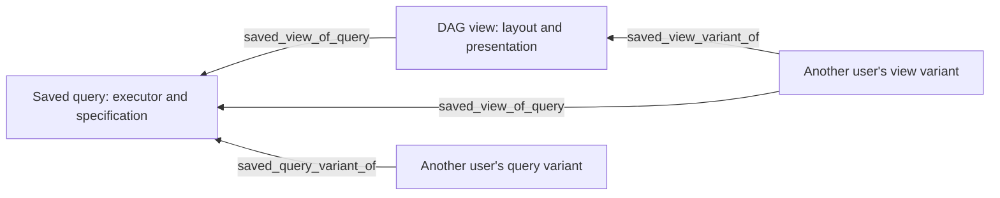

# Saved queries and independent DAG views

TapDB stores a saved query and a DAG view as separate typed native instances.
Each has its own EUID, creator and database-owned `record_revision`. Changing
presentation does not change the query. Changing a query does not overwrite a
view. The same query can support multiple views, and a tenant user can create a
variant without editing another user's original.

This feature uses `generic_instance`, `generic_instance_lineage` and native
history. It introduces no additional tables, history store, query engine or
credential store. The packaged templates are:

| Object | Four-part template | Canonical instance prefix |
| --- | --- | --- |
| Saved query | `query/saved/generic/1.0` | `GSE` |
| DAG view | `view/dag/generic/1.0` | `GSE` |

The deployment's explicit issuance profile governs the effective prefix. For
example, a configured single-prefix profile projects these core templates onto
that prefix. Code identifies them by template coordinates, never by EUID prefix.
The native template seed operation must have loaded the definitions before use;
the API does not seed or infer missing templates.

The template is the native saved-definition object envelope. Its version remains
`1.0`: it already stores a versioned definition in JSON properties rather than
declaring the presentation fields in its template schema. The executable
presentation contract in TapDB 13.0.0 is **`tapdb.dag-view-definition/v2`**. No template
rewrite, database migration, or additional relationship store is required.



The diagram displays child-to-parent provenance arrows. Native storage retains
its parent/child endpoint columns: the original is the parent of a variant, and
the query is the parent of a view binding. Every relationship is a native lineage
object with its own EUID and revision. Variant lineage records the copied source
revision. A variant is an independent copy; later original edits do not overwrite
it. A view variant initially binds to the same current query as its source.

## Authentication and tenant sharing

All routes use the host's existing authenticated-user dependency. Any user in the
selected tenant can list, read and run its saved definitions, create definitions,
or create variants. Only a definition's creator or an authenticated administrator
within that tenant can edit, rebind or soft-delete it. Creator identity is the
native attribution issuer and subject, not an editable username or email.

An embedded host supplies `actor_issuer`, `actor_subject`, and, for a runtime
configured for multiple tenants, a trusted `tenant_id` from its authentication
layer. The tenant must be in the existing runtime's configured primary/additional
tenant scope. When the runtime selects exactly one explicit primary tenant, that
configured tenant is used. No tenant, ambiguous tenant selection, or an identity
outside the configured scope fails. Request bodies cannot set the creator, grant
administrator status or choose a tenant. Native RLS remains in effect.

Generic object create/edit/delete/repair and generic lineage APIs cannot change
these definitions or their relationships. Their dedicated service owns those
operations. Native administrative history/correction remains the existing
administrative control; there is no new user-level correction path.

## API contract

Paths are relative to the mounted TapDB router prefix. Every mutation is an API
operation; a GUI should call these same endpoints.

| Method and path | Behavior |
| --- | --- |
| `GET /api/saved-query-executors` | Registered executor schemas, definition schemas and the required `view_definition_contract` |
| `GET /api/saved-queries` | Tenant queries; `limit` and native-UID `after_uid` pagination |
| `POST /api/saved-queries` | Create a query owned by the authenticated creator |
| `GET /api/saved-queries/{euid}` | Current definition and native relationship identities |
| `PUT /api/saved-queries/{euid}` | Creator/admin replacement with `expected_revision` |
| `DELETE /api/saved-queries/{euid}` | Creator/admin soft-delete with `expected_revision` |
| `POST /api/saved-queries/{euid}/variants` | New creator-owned query linked to the source revision |
| `GET /api/saved-queries/{euid}/revisions/{revision}` | Native historical state, optionally in explicit `epoch` |
| `POST /api/saved-queries/{euid}/run` | Read-only execution at the explicitly expected revision |
| `GET, POST /api/dag-views` | List/create independently owned DAG views |
| `GET, PUT, DELETE /api/dag-views/{euid}` | Read/edit/soft-delete the view |
| `POST /api/dag-views/{euid}/variants` | Copy presentation and its query binding, with native variant lineage |
| `GET /api/dag-views/{euid}/revisions/{revision}` | Native view revision, optionally in explicit `epoch` |
| `PUT /api/dag-views/{euid}/query` | Bind or unbind a saved query through native lineage |
| `POST /api/dag-views/{euid}/run` | Return view settings and the result of its linked query |

Create accepts `name`, optional `description`, and `definition`. Update replaces
those fields and requires `expected_revision`. Variant creation accepts the same
fields plus the source `expected_revision`; omitting `definition` copies the
source's definition. A delete body supplies `expected_revision`.

Binding accepts the view's `expected_revision`, a `query_euid` returned by the
owning API, and that query's `expected_query_revision`. Explicit null
`query_euid` unbinds; the query revision must also be null. Rebinding soft-deletes
the prior native relationship and creates its replacement in one transaction.
The view stores `query_binding_recorded_at` from the changed edge's native
timestamp as display metadata, giving the view a real native revision change.
The edge remains the authoritative query relationship. Repeating the already
selected binding is a no-op. A query is not revision-pinned by a binding: execution
requires the caller to supply the current expected query revision explicitly.

Run accepts `expected_revision` and structured `parameters`. View run also
requires `expected_query_revision`. Both execute in the native scoped runtime's
PostgreSQL read-only repeatable-read transaction. They persist no run record,
result snapshot, cache or credentials. A revision conflict returns HTTP 409;
unavailable tenant objects return 404; ownership denial returns 403; malformed
definitions or unavailable executors return 422. A deleted linked query cannot
run. Missing or ambiguous query bindings are explicit errors.

View create/update and view execution require a complete v2 definition. A
variant without an explicit replacement definition also requires its source to
be v2. Existing v1 objects remain listable/readable, and their native revisions
remain available. No read operation converts or rewrites them. To use one with
the current executable contract, its creator/admin supplies a complete v2
definition through guarded `PUT`, or a tenant user creates a variant with an
explicit v2 definition. A v1 execution or implicit v1 copy returns HTTP 422; there
is no compatibility path or inferred default expansion. The saved-query,
saved-definition envelope and result envelope contracts are unchanged.

History responses come directly from `HistoryService.object_at`. That service's
epoch and completeness semantics apply; unavailable past history is not
reconstructed from present data. Edge revisions and operation grouping are
available through the existing native history API.

## Structured definitions

This creates a tenant-local search definition without SQL:

```json
{
  "name": "Active material search",
  "description": "Search the current tenant's material instances.",
  "definition": {
    "contract": "tapdb.saved-query-definition/v1",
    "executor": "tapdb.object-search/v1",
    "specification": {
      "record_type": "instance",
      "category": "content"
    }
  }
}
```

Use an actual category from the owning service's current catalog. The built-in
executor is the native paginated object search service: its specification can
select instances or lineage by exact EUID, name/EUID substring, category, type,
subtype and relationship type. Run parameters are `limit` and `cursor`; tenant
scope comes from authentication. It returns native search results, not a labware
projection. A host registers its own graph or labware projection executor when
that result is needed.

A view's presentation definition is separate:

```json
{
  "name": "Labware and material provenance",
  "definition": {
    "contract": "tapdb.dag-view-definition/v2",
    "layout": "labware",
    "arrow_direction": "child_to_parent",
    "content_mode": "parallel",
    "time_order": "older_left",
    "group_offsets": [],
    "node_offsets": [],
    "lanes": [],
    "visibility": {
      "historical_placements": true,
      "empty_positions": true,
      "hidden_nodes": [],
      "hidden_edges": [],
      "hidden_relationship_types": []
    },
    "viewport": {"mode": "fit"},
    "replay": {"rate": 1.0, "fit_on_step": true},
    "labels": ["euid", "name", "type", "position"]
  }
}
```

All v2 fields shown above are explicit; no old field names are accepted as
aliases. Empty lists explicitly mean no overrides of that kind. A view is
presentation, not a graph snapshot: it stores no containment membership,
geometry, physical position assignment, biological relationship, or inferred
history. The owning projection remains authoritative for those facts.

| Field | Typed presentation contract |
| --- | --- |
| `layout` | Renderer layout identifier; an unsupported layout is explained, not replaced. |
| `content_mode` | `embedded` or `parallel`. Placement in a content lane does not change material ownership. |
| `group_offsets` | List of `{group: {service_id, euid}, delta: {x, y}}`. Each native owning-service/EUID pair occurs at most once. Deltas use graph model coordinates. |
| `node_offsets` | List of `{node: {service_id, euid}, delta: {x, y}}` for independent positioning of material or other individually movable projected nodes. Each native owning-service/EUID pair occurs at most once. Deltas use graph model coordinates and do not move descendants. |
| `lanes` | Ordered list of `{lane_id, visible, delta: {x, y}}`, with unique IDs declared by the projection/layout. It orders those lanes and applies their visibility and model-coordinate deltas. Unlisted lanes retain the owning projection's arrangement. An empty list makes no lane overrides. |
| `visibility` | Explicit historical-placement and empty-position switches, hidden node and edge selectors (`{service_id, euid}`), and hidden native relationship types. This only filters rendering. |
| `viewport` | Either `{mode: "fit"}` or `{mode: "fixed", pan: {x, y}, zoom: positive_number}`. Pan uses rendered CSS-pixel coordinates; zoom is dimensionless. A fixed viewport has no inferred pan/zoom. |
| `replay` | `rate` is `0.2`, `0.5`, `1.0`, `2.0` or `5.0`, all forward. `fit_on_step` controls fitting when an operation step changes; it may supersede a fixed initial viewport. It does not change timestamps, operation groups, or native history. |
| `labels` | Explicit list drawn from `euid`, `name`, `type` and `position`. |

Coordinates must be finite, and zoom must be positive. EUID selectors accept
canonical native identifiers and must be copied from persisted objects/edges
returned by the owning projection, not generated display IDs. Shape validation
does not claim that an identifier is currently in the query result. The substrate
does not run a query or issue database/network probes merely to save a view.
The consumer explains selectors or lane IDs absent from the projection instead
of inventing an object, silently dropping the saved preference, or changing its
query. An object absent only from the selected playback frame retains its
presentation setting for frames in which it appears.

For example, a caller can construct a group offset from a selected persisted
projection node without inventing an EUID:

```python
group_offset = {
    "group": {
        "service_id": selected_node["service_id"],
        "euid": selected_node["euid"],
    },
    "delta": {"x": 120.0, "y": -40.0},
}
```

The renderer derives a group's active descendants at the selected time from
the projection. It applies the group's delta to the plate/rack header, its fixed
wells/slots, currently placed tubes, and contained material, including material
shown in a parallel lane. A node's final model position is its projected base
position plus its lane delta, its active containing group's delta, and its own
node delta. Independent material dragging updates only that material's
`node_offsets` entry. Later group movement still carries the material while
preserving its independent adjustment; its owning-holder edge follows the
displayed node. A node offset does not move that node's descendants. A renderer
keeps fixed wells/slots locked to their grid; it explains a requested independent
offset for such a node as unsupported rather than changing physical geometry.

These deltas never change fixed row/column addresses or material ownership.
Historical placement edges keep their original slot endpoints. The view cannot
provide a replacement list of children, custom slots, or relationship endpoints.
A group selector that is not a projected containing object is explained as
unsupported rather than treated as invented containment.

Visibility does not delete objects or lineage and does not remove them from the
query result or a manifest. The consumer omits rendered edges with hidden
endpoints; their native identities and history stay in the projection. Saving
group/node offsets, visibility, lanes, viewport or replay preferences uses the same guarded
view API and creates an ordinary native view revision. Query revisions and
bindings are unchanged. Variants copy these settings into an independently
owned native view linked through the existing variant lineage.

A consuming renderer must implement the requested layout and presentation
contract or explain that they are unavailable. The substrate does not silently
substitute another layout or execute an unregistered query implementation.

## Host execution integration

`QueryExecutor` pairs a service callable with strict Pydantic specification and
parameter models. Pass explicit registrations to
`saved_queries_router(config_path=..., require_user=..., executors=...)` when
mounting the API. The built-in executor identifier cannot be overridden.

```python
from daylily_tapdb.services.saved_queries import DefinitionModel, QueryExecutor

class ProjectionSpecification(DefinitionModel):
    include_material: bool = True

class ProjectionParameters(DefinitionModel):
    start_euid: str

def project(session, specification, parameters, principal, owner_repo_name):
    return owning_projection_service(
        session=session,
        start_euid=parameters["start_euid"],
        tenant_id=principal.tenant_id,
        include_material=specification["include_material"],
    )

executors = {
    "owner.labware/v1": QueryExecutor(
        ProjectionSpecification, ProjectionParameters, project
    )
}
```

`owning_projection_service` in this example denotes the host's implementation;
it is not an installed TapDB function. A registration's schemas must forbid
unknown fields. Saved definitions and parameters do not accept SQL, connection
strings, headers, passwords, tokens or credential fields. Executors must use the
supplied native session and authenticated principal, must remain read-only, and
must not commit, discover credentials or fetch arbitrary user-selected URLs.
The host owns service-specific semantics and output contracts. Native SQLAlchemy
services and configured authorization remain the execution authority.

Library callers use `SavedQueryService` with an explicit `SavedQueryPrincipal`,
domain, owner and caller-owned native transaction. They must supply the same
authenticated scope and a read-only transaction for execution; the web adapter
does this through `RuntimeDBConnection.session_scope(read_only=True)`.
