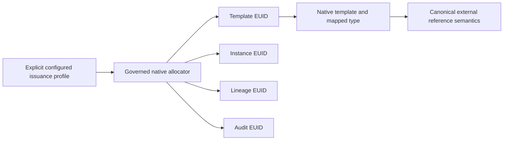

# TapDB 12.0.0

TapDB 12 separates allocation identity from object type and makes native
template authoring available to constrained, authenticated runtime clients.
It retains TapDB 11 attribution, revision guards, audit history, native
factories, tenant policies, messaging, external references and recovery tools.

## Breaking changes

- Every configured connection supplies `meta.issuance_profile`, with version 1
  and either `mode: canonical` or `mode: single_prefix` plus an explicit prefix.
  Direct `TAPDBConnection` callers pass the same profile explicitly. Missing
  configuration fails; an existing database is never silently adopted.
- Native schema/bootstrap binds the issuance profile to its domain and owner.
  Config changes cannot rewrite an existing binding or historical identity.
- The Admin GUI's persisted actions use published APIs. Removed duplicate form
  POST handlers are not compatibility endpoints; callers use the API contract.
- Template creation inserts a new exact four-part coordinate. Existing
  definitions, including retired coordinates, require a new version.
- Saved-query and DAG-view definitions use their dedicated permission-aware
  APIs. Generic object or lineage mutation cannot bypass creator/admin rights.

## Issuance and reference identity

An external reference remains a canonical external-reference object when a
single-prefix profile changes its issuance prefix. Validation still requires
the native template shape, configured issuance identity, owning-service
contract and target reference fields. An arbitrary object or copied EUID string
does not become an external reference merely because its prefix matches.

The issuance owner and the producer service are distinct configuration values.
Prefix governance controls who allocates identities; authenticated attribution
records which service and actor performed the operation.

## Native APIs and persistence

Runtime authoring validates mapped template and instance discriminators,
governed prefix rights and existing native allocators. The caller's transaction
owns the atomic insertion and native history. The instance factory constructs
the declared SQLAlchemy mapped class, preserving typed lookup behavior.

Saved queries and independently revisioned DAG views are typed native instances
connected by lineage. Queries run against currently authorized data using a
registered owning-service executor and read-only transactions. TapDB supplies
the persistence and permission substrate; applications supply labware or
federated query semantics. No SQL text, credentials or replacement workflow
engine are stored in these definitions.

## Operational adoption

Use the supported native database/bootstrap operations with a separate
operator configuration. Runtime services receive only their constrained runtime
identity. Existing deployments require explicit schema/profile adoption; this
release does not migrate their data or change their published endpoints.

Before first assignment of a prefix, the native prefix-scoped inventory reports
stored identities, bindings, sequence reservations and supplied allocation
journals for each explicitly selected historical target. An empty receipt is
scoped to that target and is not a global allocation guarantee.

The release's requested live GUI/API acceptance is recorded by the deploying
service in its execution ledger. No pytest, lint or broad test campaign was run
as part of this release preparation.
