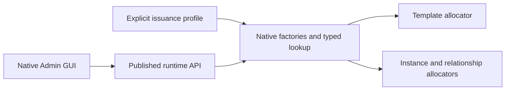

# TapDB 13.2 adoption contract

13.2.0 combines the supported source changes from 13.0.3 and 13.1.0 into one
published package. Earlier tags remain immutable. Installation does not rewrite
stored objects, move EUIDs or migrate a database implicitly.

| Explicit profile | Template identities | Instances, lineage and audit |
| --- | --- | --- |
| `canonical` | Native template prefix | Canonical core prefixes and application declarations |
| `canonical` with `template_prefix` | Selected owner-held prefix | Same canonical policy |
| `single_prefix` | Selected base prefix | Selected base prefix |
| `template_split` | Selected `template_prefix` | Selected base `prefix` |

Bloom's `vlfg-7` profile remains `template_split`, with `BG` as its base and
`BTX` for templates. Native reference semantics depend on typed templates and
the configured issuance profile, not a literal `XRF` prefix.

## Native adoption

Use the native operator schema apply/migrate path to install the unified
constraints and allocator routines. The release retains the 13.1 migration and
adds the following reconciliation migration; both earlier schema shapes are
supported. Runtime accounts retain their existing permissions and tenant scope.

For a prospective template-prefix change, use the published native
`db issuance-profile transition` plan/apply operation. Supply the exact old and
new profiles, an absolute receipt path and explicit attribution. Leave the old
config selected until apply succeeds, then use `db-config update` with the
returned profile and restart that deployment. This preserves existing EUIDs,
template definitions, history and the base allocator position. It supports
canonical overrides and split profiles through the same receipt lifecycle.

The 13.1 `db schema apply --adopt-template-prefix-from` option is superseded by
that receipt operation. Schema apply never silently changes a differing profile.
Explicit `--claim-template-prefix` remains available for a canonical template
prefix after the registry's first-assignment review. Runtime template authoring
requires the existing governed template and instance allocators; it neither
creates sequences nor obtains operator credentials.



## Installation and service pins

```bash
python -m pip install "daylily-tapdb[aurora,gui]==13.2.0"
```

Consumers should use the exact package version and their native deployment
configuration. Release publication, database adoption and live workflow
acceptance are separate results recorded by the owning deployment.
